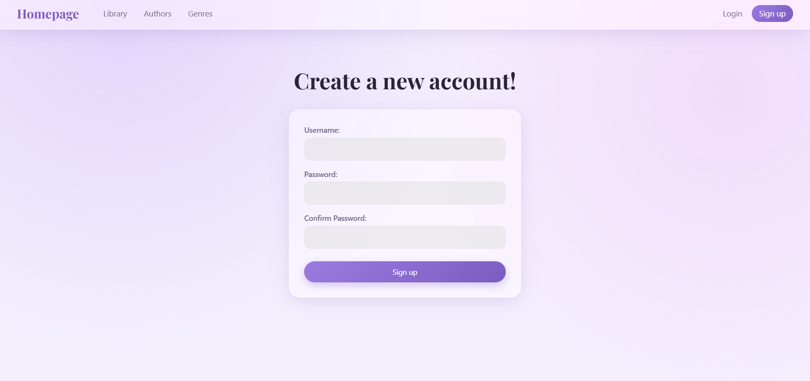
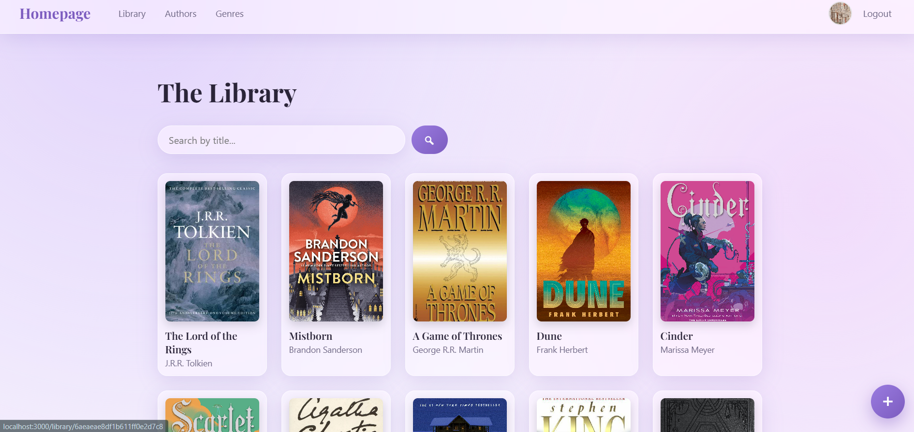
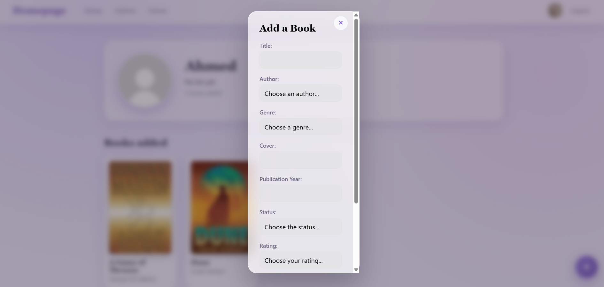
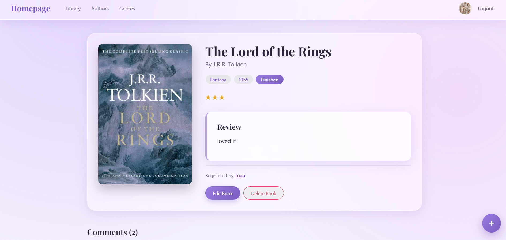
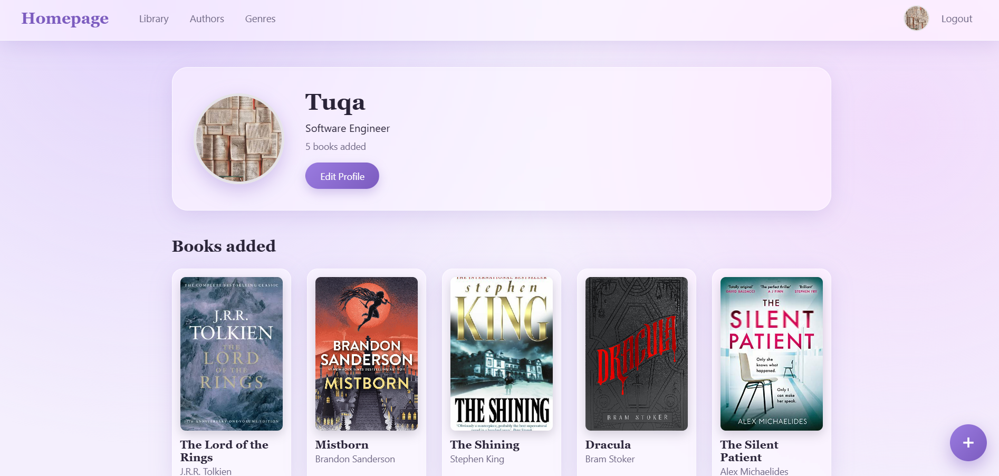

# Library
A full-stack web app for tracking books. Users can sign up, add books, and comment on each other's books.

## Overview
The Library App is a place to keep track of the books you read and discover what other readers are adding. Every book belong to an author and a genre, and the person who adds a book can edit or delete it. Other users can leave comments on any book and visit the profile of whoever added it.

## Screenshots






## Technologies Used
EJS,
CSS,
Node.js,
Express,
MongoDB,
express-session,
bcrypt,
method-override,
dotenv

## Getting Started
1. Create folder for the library and cd into it
2. Perform the following commands in the command line
```bash
git clone https://github.com/Tuqahmed/project-2.git .
rm -rf .git
rm README.md
```
3. Create a .env file with the following 2 values of your database connection:
```
MONGODB_URI=your-mongo-db-connection-string
SESSION_SECRET=your-secret-key
PORT=3000
```
4. run:
```bash
npm i
```

## User Stories
- As a user, I want to see a display of all books.
- As a user, I want to see an add book form.
- As a user, I want to add a book.
- As a user, I want to see the book details.
- As a user, I want to be able to edit a book.
- As a user, I want to be able to delete s book.
- As a user, I want to see a display of all authors.
- As a user, I want to see a display of all genres.

## Database Design


## Routes
| Method | Route                        | Description                         |
|--------|------------------------------|-------------------------------------|
| GET    | /                            | Display home page                   |
| GET    | /library                     | Display all books                   |
| GET    | /library/authors             | Display books grouped by author     |
| GET    | /library/genres              | Display books grouped by genre      |
| GET    | /library/:bookId             | Show book details                   |
| POST   | /library                     | Create a book                       |
| PUT    | /library/:bookId             | Update the book                     |
| DELETE | /library/:bookId             | Delete the book                     |
| POST   | /library/:bookId/comments    | Add a comment to a book             |
| GET    | /users/:userId               | Display the users' profile          |
| PUT    | /users/:userId               | Update the users profile info       |
| GET    | /auth/sign-up                | Display sign-up form                |
| POSt   | /auth/sign-up                | Create an account                   |
| GET    | /auth/sign-in                | Display login form                  |
| POST   | /auth/sign-in                | Log in                              |
| GET    | /auth/sign-out               | Log out                             |

## Features
- **Authentication:** sign up, log in, and log out with hashed passwords and session cookies.
- **Full CRUD on books:** create, read, update, and delete, with ownership checks on the server.
- **Relationships:** each book references an author, a genre, a status, a rating and an owner.
- **Reviews:** a written review shown on the book details page.
- **Comments:** any logged-in user can comment.
- **Search:** find books by title, case-insensitive.
- **Browse by author or genre.**
- **User Profiles:** a picture, about section, and the user's books.
- **Navbar picture** that links to your profile.
- **Popup forms:** add and edit books without leaving the page.
- **Toast notifications** for success and error messages.

## Future Enhancements
- **Reading dashboard:** stats cards and charts for genres read, ratings, and book statuses.
- **Image uploads** for covers and profile pictures.
- **Reading progress** with pages read and a progress bar.
- **Favorites:** save books to a personal list.
- **Sort and filter** by genre, status, rating or year.
- **Author autocomplete** using the Open Library API, including cover images.
- **Follow other users** and see an activity feed.
- **Likes and replies** on comments.
- **Dark mode** toggle.

## Credits
- freeCodeCamp
- w3Schools
- MDN