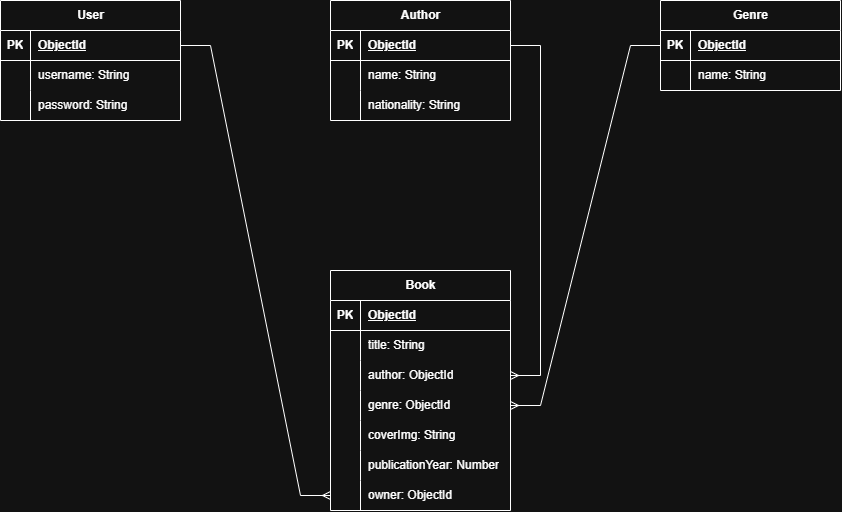

# Library

## Overview

## Screenshots

## Technologies Used

## Getting Started

## User Stories
- As a user, I want to see a display of all books.
- As a user, I want to see an add book form.
- As a user, I want to add a book.
- As a user, I want to see the book details.
- As a user, I want to be able to edit a book.
- As a user, I want to be able to delete s book.
- As a user, I want to see a display of all authors.
- As a user, I want to see a display of all genres.

## Database Design

## Routes
| Method | Route               | Description            |
|--------|---------------------|------------------------|
| GET    | /                   | Display home page      |
| GET    | /books              | Display all books      |
| GET    | /books/new          | Display add book form  |
| POST   | /books              | Create a book          |
| GET    | /books/:bookId      | Show book details      |
| GET    | /books/:bookId/edit | Display edit book form |
| PUT    | /books/:bookId      | Update the book        |
| DELETE | /books/:bookId      | delete the book        |
| GET    | /authors            | Display all authors    |
| GET    | /genres             | Display all genres     |

## Features

## Future Enhancements

## Credits